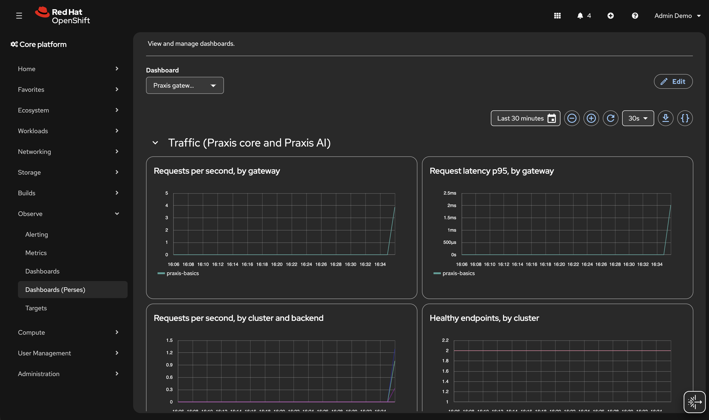

# Praxis on OpenShift AI Lab

Learn Praxis end to end on OpenShift AI, in two parts:

| Part | Gateway | Backends | You learn |
|---|---|---|---|
| **0. Basics** | Praxis core | echo servers | listeners, chains and pipelines; routing; load balancing; rate limiting; health checks; hot reload; metrics |
| **1. AI gateway** | Praxis AI | simulated LLMs served by OpenShift AI | routing on the model, balancing and failover across InferenceServices, streaming, Anthropic ⇄ OpenAI translation, token and time-to-first-token metrics |

No GPUs are used. The LLMs are served by OpenShift AI as KServe
InferenceServices, using a ServingRuntime for
[llm-d-inference-sim](https://github.com/llm-d/llm-d-inference-sim), a
CPU-only stand-in for vLLM that speaks the OpenAI and Anthropic APIs, reports
token usage, and simulates realistic latency.

**Prerequisite:** Red Hat OpenShift AI 3.x with KServe enabled. Tested with
OpenShift 4.22 and OpenShift AI 3.5. If the cluster doesn't have it, install
it with the files in [prereqs/](prereqs/):

```console
oc apply -f lab/openshift/prereqs/01-openshift-ai-operator.yaml
oc -n redhat-ods-operator get csv -w      # wait for rhods-operator Succeeded
oc apply -f lab/openshift/prereqs/02-datasciencecluster.yaml
```

**Optional, for the Perses dashboard:** the Cluster Observability Operator
with Perses enabled in its monitoring console plugin:

```console
oc apply -f lab/openshift/prereqs/03-cluster-observability-operator.yaml
oc -n openshift-cluster-observability-operator get csv -w   # wait for Succeeded
oc apply -f lab/openshift/prereqs/04-perses-ui-plugin.yaml
```

Background reading: [../CONCEPTS.md](../CONCEPTS.md) (how Praxis works) and
[../AI.md](../AI.md) (Praxis AI).

```text
                               namespace: praxis
                 ┌────────────────────────────────────────────────────────┐
 Route ─────────►│ praxis-basics  listener web      ─┐                    │
 Route (limited)►│  (core 0.7.5)  listener limited  ─┴─► backend-a/b/c    │ echo (whoami)
                 │                                                        │
 Route ─────────►│ praxis-ai      (AI 0.9.0) ──┬─► granite-a, granite-b   │ InferenceServices
                 │                             └─► qwen                   │ (OpenShift AI)
                 │                                                        │
                 │ ServiceMonitors ─► OpenShift user-workload monitoring  │
                 └────────────────────────────────────────────────────────┘
```

| Component | Image | Notes |
|---|---|---|
| `backend-a`, `-b`, `-c` | `docker.io/traefik/whoami:v1.10` | echo the request back; print `Name: backend-x` |
| `praxis-basics` | `ghcr.io/praxis-proxy/praxis:0.7.5` | Part 0 gateway, ConfigMap `praxis-basics-config` |
| `llm-d-inference-sim` | ServingRuntime, `ghcr.io/llm-d/llm-d-inference-sim:v1.1.0` | how KServe runs the simulator |
| `granite-a`, `granite-b` | InferenceServices | the same model, `granite-3.1-8b-instruct`, served twice; time to first token 150 ms |
| `qwen` | InferenceService | `qwen3-8b`; time to first token 300 ms |
| `praxis-ai` | `ghcr.io/praxis-proxy/ai:0.9.0` | Part 1 gateway, ConfigMap `praxis-ai-config` |

**Guardrails:**
- Everything lives in the `praxis` namespace.
- The ResourceQuota `no-gpus` forbids requesting any GPU there.
- Every container the lab defines, including the simulator's ServingRuntime,
  sets `NVIDIA_VISIBLE_DEVICES=void`, so the NVIDIA runtime never hands it a
  GPU even on a GPU node.
- All pods run under OpenShift's default `restricted-v2` security context:
  random UID, read-only root filesystem, all capabilities dropped.

## Set up

```console
lab/openshift/setup.sh

B=https://$(oc -n praxis get route praxis-basics -o jsonpath='{.spec.host}')
L=https://$(oc -n praxis get route praxis-basics-limited -o jsonpath='{.spec.host}')
AI=https://$(oc -n praxis get route praxis-ai -o jsonpath='{.spec.host}')
```

---

# Part 0: Praxis basics

Config: [06-praxis-basics.yaml](06-praxis-basics.yaml). The backends are
whoami echo servers: each echoes the request it received, so you can see what
Praxis added or changed.

## 1. Listeners, filter chains and pipelines

```console
oc -n praxis get cm praxis-basics-config -o jsonpath='{.data.praxis\.yaml}'
```

In Praxis, **everything is a filter**: routing, load balancing, rate
limiting, header changes, static replies. The config arranges them in three
layers:

| Term | What it is | In this config |
|---|---|---|
| **Listener** | An address and port, plus the list of chains to run | `web` (port 8080) and `limited` (8081), each with its own Route |
| **Filter chain** | A named, reusable list of filters | `observability`, `throttle`, `edge`, `routing` |
| **Pipeline** | The flat list of filters a listener actually runs, built at startup | see below |

Praxis joins each listener's chains, in order, into one pipeline:

```text
listener web:     [observability] + [edge] + [routing]
  → request_id, access_log, headers, static_response, router, load_balancer

listener limited: [observability] + [throttle] + [edge] + [routing]
  → request_id, access_log, rate_limit, headers, static_response, router, load_balancer
```

The two listeners differ by one chain name, and no filter config is
duplicated.

**How a pipeline runs:**
- **Request filters run in order**, top to bottom.
- **Response filters run in reverse**, bottom to top.
- **Any filter can answer the request itself** and stop the pipeline. See
  it happen:

```console
curl -i $B/         # static_response answers; router and load_balancer never run
curl -i $B/nope     # 404: the router found no matching route
```

Two more terms:
- **`router`** picks a *cluster*: where the request goes.
- **`load_balancer`** picks an *endpoint* in that cluster: which backend
  instance gets it.

They are separate filters. More detail:
[Chains become a pipeline](../CONCEPTS.md#chains-become-a-pipeline).

## 2. Routing on path and headers

```console
curl -s $B/app | grep Name                      # path /app -> cluster app
curl -s $B/v2 | grep Name                       # /v2 without the header -> app
curl -s -H 'x-version: v2' $B/v2 | grep Name    # /v2 with x-version: v2 -> backend-c
```

A prefix matches at a `/` boundary: `/app` matches `/app` and `/app/hello`,
but not `/application`. When several routes match, the most specific wins:

- **The longer prefix wins.** With routes for `/` and `/api`, a request for
  `/api/users` goes to `/api`; `/` only catches what nothing else matches.
- **On a tie, more conditions win.** The two `/v2` routes share a prefix, so
  when `x-version: v2` is present, the route that requires it wins.

Without the header, `/v2` can answer from backend-a or backend-b. The router
only picks the `app` cluster; the `load_balancer` then picks one of its two
endpoints by round robin, so repeated requests alternate between them.

The order of the routes in the file doesn't matter.

## 3. Load balancing and header changes

```console
for i in 1 2 3 4; do curl -s $B/app | grep Name; done                      # round robin
for i in $(seq 1 20); do curl -s $B/canary | grep Name; done | sort | uniq -c   # weighted 3:1
curl -s $B/app/hello                                                        # full echo
curl -si $B/app | grep -i -E 'x-powered-by|x-request-id'
```

Expected:

- **`/app`** alternates `backend-a` and `backend-b`.
- **`/canary`** gives exactly 15 `backend-a` and 5 `backend-c`. The cluster
  weights them 3 and 1, and weighted round robin is deterministic. Other
  strategies include least connections, consistent hash, power of two
  choices and zone-aware.
- **The echoed request** shows what Praxis added: `X-Via: praxis-lab` from
  the `headers` filter, `X-Request-Id` from `request_id`, and
  `Via: 1.1 praxis`. The `Forwarded` and `X-Forwarded-*` headers come from
  the OpenShift router, a second proxy in front of Praxis.
- **The response** carries `x-powered-by: praxis` and `X-Request-Id`.

Each `load_balancer` cluster lists its backends in `trusted_private_endpoints`.
Service DNS names resolve to private cluster IPs, and Praxis refuses to
connect to private IPs unless the name is on that allowlist. It's a guard
against server-side request forgery.

## 4. Rate limiting

```console
for i in $(seq 1 10); do curl -s -o /dev/null -w '%{http_code} ' $L/app; done; echo
curl -si $L/app | grep -i -E '^HTTP|ratelimit|retry-after'
for i in $(seq 1 10); do curl -s -o /dev/null -w '%{http_code} ' $B/app; done; echo
```

The `limited` listener has the `throttle` chain, a token bucket holding 4
requests and refilling at 2 per second. After the first few requests you get
`429` with `Retry-After` and `X-RateLimit-*` headers. Over the internet
usually 5 or 6 succeed, because the bucket refills between requests. The
`web` listener is never limited.

Why a separate listener rather than a `when: path_prefix: ...` condition on
one listener? Praxis treats `rate_limit` as a **security filter** and refuses
to start if a security filter has a condition, because a condition is a
bypass.

## 5. Health checks

The `app` cluster probes `GET /health` on each backend every 2 seconds.
whoami lets you change what its `/health` returns with a POST. The whoami
image has no shell, so send it from the Praxis pod, which has busybox `wget`:

```console
H=http://backend-a.praxis.svc.cluster.local:8080/health
oc -n praxis exec deploy/praxis-basics -- wget -qO- --post-data=500 $H   # make it fail
sleep 5
oc -n praxis exec deploy/praxis-basics -- wget -qO- http://127.0.0.1:9902/ready; echo
for i in 1 2 3 4; do curl -s $B/app | grep Name; done                    # only backend-b
oc -n praxis exec deploy/praxis-basics -- wget -qO- --post-data=200 $H   # recover
```

`/ready` shows `app: healthy 1, unhealthy 1`, and traffic avoids backend-a
until it recovers. `/ready` is also the Deployment's **readiness probe**, and
`/healthy` its **liveness probe**, both on the metrics port 9902.

## 6. Hot reload from the ConfigMap

```console
oc -n praxis edit configmap praxis-basics-config
#   change:  value: praxis          (the X-Powered-By response header)
#   to:      value: praxis-reloaded
oc -n praxis logs -f deploy/praxis-basics | grep -i reload   # wait for "reload complete"
curl -si $B/app | grep -i x-powered-by
oc -n praxis get pods -l app=praxis-basics                   # RESTARTS still 0
```

The kubelet updates the mounted ConfigMap, usually within a minute. Praxis
validates the new config and swaps it in without restarting the pod. Routes,
filters, clusters and weights reload live. Listener addresses, protocol and
TLS on/off need a restart.

Now break it: point the `/canary` route at `cluster: does-not-exist`. The
reload is rejected and the old config keeps serving.

Two things to know:
- **Mount the ConfigMap as a directory, not with `subPath`.** Kubernetes only
  updates directory mounts, so a `subPath` mount never sees changes.
- **Check headers on `/app`, not `/`.** Replies Praxis generates itself, such
  as the static `/`, 404s and 429s, don't get response-phase headers.

Put it back: `oc apply -f lab/openshift/06-praxis-basics.yaml`.

## 7. Observability

```console
oc -n praxis logs deploy/praxis-basics | grep access_log | tail -3
oc -n praxis exec deploy/praxis-basics -- wget -qO- http://127.0.0.1:9902/metrics \
  | grep '^praxis_' | cut -d'{' -f1 | sort -u
```

- **Access logs:** one line per request.
- **Metrics:** Prometheus metrics for requests, latency, upstreams, health,
  rate limits and reloads.

A `ServiceMonitor` feeds the metrics into OpenShift user-workload
monitoring. In the console, go to **Observe → Metrics** and try:

Each query box takes one expression: run the first, then use **Add query**
for each of the others.

```promql
sum by (job) (rate(praxis_http_requests_total{namespace="praxis"}[5m]))
```

```promql
praxis_upstream_healthy_endpoints{namespace="praxis"}
```

```promql
praxis_config_reload_total{namespace="praxis"}
```

For an at-a-glance view, create the **Perses dashboard**
([07-perses-dashboard.yaml](07-perses-dashboard.yaml): a datasource for
OpenShift's Thanos querier, and a dashboard). `setup.sh` already applies it
when Perses is installed:

```console
oc apply -f lab/openshift/07-perses-dashboard.yaml
for i in $(seq 1 60); do curl -s -o /dev/null $B/app; curl -s -o /dev/null $B/canary; curl -s -o /dev/null $L/app; done
```

Then go to **Observe → Dashboards (Perses)**, project **praxis**, and open
**Praxis gateways**.

 The Traffic row shows the canary's 3:1 split, the
round robin across `app`, and rate limiting. The AI gateway row fills in
during Part 1. Note that upstream panels group by `exported_endpoint`: the
scrape adds its own `endpoint` label, so Prometheus renames Praxis's.

---

# Part 1: Praxis AI as an AI gateway

Config: [20-praxis-ai.yaml](20-praxis-ai.yaml). Praxis AI is Praxis core
plus AI filters, so everything from Part 0 applies: the same listeners,
chains, router, load balancer, health checks, hot reload and metrics. Its
listener runs `observability → classify → translate → routing`.

A helper for the requests below:

```console
chat() {  # chat <model> [extra curl args...]
  local model=$1; shift
  curl -s "$AI/v1/chat/completions" -H 'content-type: application/json' "$@" \
    -d "{\"model\":\"$model\",\"max_tokens\":20,\"messages\":[{\"role\":\"user\",\"content\":\"hi\"}]}"
}
```

## 8. One endpoint, many models

```console
chat granite-3.1-8b-instruct | head -c 200; echo
chat qwen3-8b | head -c 200; echo
chat gpt-4o -i | head -1                                                   # 404: unknown model
chat granite-3.1-8b-instruct -H 'X-Model: qwen3-8b' -D - -o /dev/null | grep -i x-inference-pod
```

All OpenAI clients call the same URL. Praxis picks the backend from the
`model` field **inside the JSON body**, in three steps:

1. **`ai_operation`** identifies the AI API and operation (OpenAI Chat,
   Responses, Anthropic Messages, ...) from the method and path alone, before
   reading any body.
2. **`model_to_header`** reads `model` from the body without forwarding
   anything yet, and copies it into the `X-Model` header. It **replaces** any
   client-sent `X-Model`, which is why the last request above still went to
   granite.
3. **`router`** matches `X-Model` to a cluster, as in Part 0 step 2.

This is the **classify → promote → route** pattern, the core way Praxis
turns request content into routing decisions.

## 9. Balancing and failover across InferenceServices

```console
for i in 1 2 3 4; do chat granite-3.1-8b-instruct -D - -o /dev/null | grep -i x-inference-pod; done
for i in 1 2; do chat qwen3-8b -D - -o /dev/null | grep -i x-inference-pod; done
```

The simulator answers with an `x-inference-pod` header naming the pod.
`granite-a` and `granite-b` are two InferenceServices serving the same
model, like one model deployed in two zones. Praxis lists both in its
`granite` cluster, alternates between them, and health-checks each one.

Now stop `granite-b`. The `serving.kserve.io/stop` annotation is what the
**Stop** action in the OpenShift AI dashboard sets:

```console
oc -n praxis annotate inferenceservice granite-b serving.kserve.io/stop=true --overwrite
sleep 10
oc -n praxis exec deploy/praxis-ai -- wget -qO- http://127.0.0.1:9902/metrics | grep '^praxis_upstream_healthy_endpoints'
for i in 1 2 3 4; do chat granite-3.1-8b-instruct -D - -o /dev/null | grep -i x-inference-pod; done

oc -n praxis annotate inferenceservice granite-b serving.kserve.io/stop=false --overwrite
oc -n praxis wait --for=condition=Ready inferenceservice/granite-b --timeout=180s
sleep 60
for i in 1 2 3 4; do chat granite-3.1-8b-instruct -D - -o /dev/null | grep -i x-inference-pod; done
```

While it's stopped, `praxis_upstream_healthy_endpoints{cluster="granite"}`
is 1 and all traffic goes to `granite-a`. The metric is used instead of
`/ready`, which can be out of date after a hot reload (finding 9). After the
restart, `granite-b` rejoins with a new pod. Its predictor Service is
headless, so the new pod has a new IP, and Praxis caches DNS answers for 60
seconds: until then, requests sent to the old IP fail with a 502 or 504.
That's why the restart waits 60 seconds before sending traffic.

Errors from the model itself are passed through unchanged. The simulator
can fail on demand:

```console
chat qwen3-8b -H 'X-Return-Error: 429' -w '\n%{http_code}\n'
```

## 10. Streaming passes straight through

```console
curl -sN $AI/v1/chat/completions -H 'content-type: application/json' \
  -d '{"model":"qwen3-8b","max_tokens":10,"stream":true,"messages":[{"role":"user","content":"hi"}]}'
```

Tokens arrive one SSE `data:` event at a time, with about 300 ms before the
first one. Praxis doesn't buffer the response.

## 11. Anthropic clients, OpenAI backends

The simulated models are reached on OpenAI Chat Completions. Send an
**Anthropic Messages** request anyway:

```console
curl -s $AI/v1/messages -H 'content-type: application/json' -H 'anthropic-version: 2023-06-01' \
  -d '{"model":"qwen3-8b","max_tokens":20,"messages":[{"role":"user","content":"hello"}]}'; echo
```

The client gets an Anthropic-format reply (`"type":"message"`,
`"stop_reason"`, `"usage":{"input_tokens"...}`). Its `id` starts with
`msg_chatcmpl-`: the backend answered in OpenAI Chat format, and Praxis
translated the request, the path (`/v1/messages` → `/v1/chat/completions`)
and the response.

Streaming is translated too, into Anthropic's event sequence:

```console
curl -sN $AI/v1/messages -H 'content-type: application/json' -H 'anthropic-version: 2023-06-01' \
  -d '{"model":"qwen3-8b","max_tokens":5,"stream":true,"messages":[{"role":"user","content":"hello"}]}' | grep '^event'
```

Expected: `message_start`, `content_block_start`, `content_block_delta` ×N,
`content_block_stop`, `message_delta`, `message_stop`.

**Translation is strict.** Anthropic features with no Chat Completions
equivalent are refused rather than silently dropped:

```console
curl -s $AI/v1/messages -H 'content-type: application/json' -H 'anthropic-version: 2023-06-01' \
  -d '{"model":"qwen3-8b","max_tokens":50,"thinking":{"type":"enabled","budget_tokens":20},"messages":[{"role":"user","content":"hi"}]}'; echo
# 400: `thinking` cannot be translated to Chat Completions
```

For clients such as Claude Code that send these features by default,
`allow_lossy_features` on the translation filter strips them and reports
that it did.

This is how an Anthropic-only client, such as Claude Code, can use models
served by vLLM, KServe or OpenShift AI that only speak OpenAI Chat.

## 12. Tokens and time to first token

OpenAI-compatible servers only report token usage in a stream when the
client sets `stream_options.include_usage`. The gateway's
`stream_usage_inject` filter sets it on every streaming chat request, so
streamed tokens are counted for every client. Generate some streaming
traffic, then read the AI metrics:

```console
for m in granite-3.1-8b-instruct qwen3-8b; do for i in 1 2 3; do
  curl -sN -o /dev/null $AI/v1/chat/completions -H 'content-type: application/json' \
    -d "{\"model\":\"$m\",\"max_tokens\":30,\"stream\":true,\"messages\":[{\"role\":\"user\",\"content\":\"hi\"}]}"
done; done

oc -n praxis exec deploy/praxis-ai -- wget -qO- http://127.0.0.1:9902/metrics \
  | grep -E '^praxis_ai_(prompt_tokens_total|output_tokens_total|ttft_seconds_(sum|count))'
```

- `praxis_ai_prompt_tokens_total` and `praxis_ai_output_tokens_total` come
  from `token_count`, labeled by **model** and **cluster**. They count tokens,
  not requests, which is what you need for cost and capacity.
- `praxis_ai_ttft_seconds` comes from `time_to_first_token`. Divide sum by
  count: about 0.15 s for granite and 0.30 s for qwen, exactly the latency
  the simulators were configured with.

The **Praxis gateways** Perses dashboard's AI gateway row now shows the same
data, and its Traffic row shows granite traffic split across `granite-a` and
`granite-b`, including the failover from step 9.

In **Observe → Metrics**:

One expression per query box (use **Add query** for the second):

```promql
sum by (model) (rate(praxis_ai_output_tokens_total{namespace="praxis"}[5m]))
```

```promql
sum by (model) (rate(praxis_ai_ttft_seconds_sum{namespace="praxis"}[5m])) / sum by (model) (rate(praxis_ai_ttft_seconds_count{namespace="praxis"}[5m]))
```

## 13. Exercise: add a model with zero downtime

1. Serve a third simulated model as an InferenceService:

   ```console
   oc apply -f lab/openshift/30-llama.yaml
   oc -n praxis wait --for=condition=Ready inferenceservice/llama --timeout=180s
   chat llama-3.1-8b-instruct -i | head -1        # 404: Praxis doesn't know it yet
   ```

2. `oc -n praxis edit configmap praxis-ai-config` and add:
   - a route: `x-model: llama-3.1-8b-instruct` → `cluster: llama`
   - a `load_balancer` cluster `llama` with endpoint
     `llama-predictor.praxis.svc.cluster.local:8000`, plus the same name in
     `trusted_private_endpoints`

3. Wait until the new route works, then ask the new model. The kubelet
   copies ConfigMap changes into the pod on its own schedule, usually within
   a minute:

   ```console
   until [ "$(chat llama-3.1-8b-instruct -o /dev/null -w '%{http_code}')" = 200 ]; do sleep 5; done
   chat llama-3.1-8b-instruct | head -c 200; echo
   ```

Solution: [solutions/20-praxis-ai-with-llama.yaml](solutions/20-praxis-ai-with-llama.yaml).
Reset with `oc apply -f lab/openshift/20-praxis-ai.yaml` and
`oc delete -f lab/openshift/30-llama.yaml`.

---

# What Praxis AI adds on top of core

| Capability | Praxis core | Praxis AI |
|---|---|---|
| Listeners, chains, routing, load balancing, rate limits, health checks, hot reload, metrics | ✅ | ✅ (same core) |
| Knows which AI API a request uses | ❌ | ✅ `ai_operation` |
| Route on body `model` | partly: generic `json_body_field` | ✅ `model_to_header` (plus AI metadata) |
| Anthropic ⇄ OpenAI translation, streaming included | ❌ | ✅ |
| Token metrics, time to first token, per model | ❌ (requests only) | ✅ |
| Guardrails, token budgets, MCP/A2A, Responses state | ❌ | ✅ (some experimental, see [AI.md](../AI.md)) |

## Findings from building this lab

1. **Connection settings belong on the `load_balancer` cluster entries.**
   Proxied traffic uses the cluster as the `load_balancer` declares it.
   `trusted_private_endpoints` set only on a top-level cluster lets the
   health checker probe but doesn't apply to requests. The configs here set
   it in both places.
2. **Praxis 0.7.5 needs the endpoints repeated.** Each `load_balancer`
   cluster entry must list its own endpoints, even when a top-level cluster
   of the same name has them. Newer Praxis copies them automatically.
   Praxis AI 0.9.0 is built on core 0.7.5, so this applies to it too.
3. **Conditions on security filters are refused** (see step 4).
4. **Replies Praxis generates itself skip response-phase headers.** The
   static `/`, 404s and 429s don't get `X-Powered-By`.
5. **Experimental filters aren't in the published image.** `token_ceiling`
   (like token rate limiting and OpenAI Responses state) crashes the pod with
   `fatal: unknown filter type`. Using them needs a custom build or the
   `-experimental` image.
6. **`token_usage_headers` can't work with OpenAI or Anthropic backends.**
   Their usage numbers are at the end of the response body, after the
   response headers are already sent, so the `Praxis-Token-*` headers never
   appear. The project's own tests document this. Use the token metrics
   instead.
7. **The metrics listener must bind `0.0.0.0`** so kubelet probes and
   Prometheus can reach it. Praxis warns about this at startup. Restrict it
   with a NetworkPolicy in production.
8. **The `rate` key "resembles" `name`.** Praxis logs a possible-typo
   warning for `rate_limit`'s `rate` field. It's a false positive; the
   project's own example triggers it too.
9. **Don't use `/ready` as the readiness probe for an AI gateway.** It
   returns 503 when any cluster has no healthy endpoints, so one stopped
   model takes the whole gateway out of its Route. In Praxis 0.7.5,
   `/ready` also keeps reporting the endpoints the pod started with after a
   hot reload, while the metrics show the real state (worth reporting
   upstream). The AI gateway here uses `/healthy` for readiness.
10. **KServe predictor Services are headless in RawDeployment mode.**
    `<name>-predictor` resolves to the pod IP, so connect to the container
    port (8000), not the Service port. With
    `rawDeploymentServiceConfig: Headed` you'd get a ClusterIP Service and
    use port 80 instead.
11. **A restarted model gets a new IP address.** With headless predictor
    Services and Praxis's 60-second DNS cache, requests can fail for up to a
    minute after a model restarts.
12. **Streamed tokens are only counted if usage is requested.** Add
    `stream_usage_inject` so the gateway sets `include_usage` for every
    client.
13. **Wait for the effect, not the log line, after a ConfigMap change.**
    The kubelet can take about a minute to deliver ConfigMap updates, and
    an older `reload complete` line can mislead a script.
14. **OpenShift's defaults just work.** All images run unmodified under
    `restricted-v2`: random UID, read-only root filesystem, no
    capabilities. KServe's added `kube-rbac-proxy` and `agent` containers
    don't get in the way. The only change needed was running whoami on
    port 8080, since a non-root UID can't bind port 80.
15. **Praxis's `endpoint` label becomes `exported_endpoint`.** The scrape
    adds its own `endpoint` label, so Prometheus renames the one on
    `praxis_upstream_requests_total`. Query `exported_endpoint`.

## Clean up

```console
lab/openshift/teardown.sh     # deletes the praxis namespace only, after asking
```
